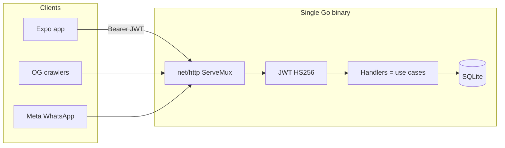
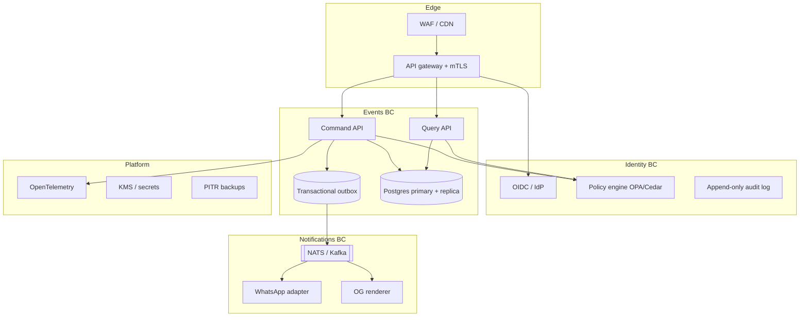

# Go backend — two architectures

Community Connect currently talks to **mock in-memory repos** or **Firebase**. This document specifies a **Go rewrite** of that backend in two shapes:

1. **Startup (bootstrap)** — what is implemented in [`backend/`](../../backend/). Ship this first.
2. **Enterprise** — the target if the product becomes a multi-tenant, regulated, SLA-bound platform. Do **not** build this on day one.

The domain stays the same: events, RSVP, USER/MOD/ADMIN, OG share pages, WhatsApp webhooks. See [00-ARCHITECTURE.md](00-ARCHITECTURE.md) and [03-USE-CASES.md](03-USE-CASES.md).

---

## Which one to run

| You are… | Use |
|----------|-----|
| Validating product, local demos, first customers | **Startup** (`backend/` SQLite + JWT) |
| Multiple regions, audit, SOC2, 99.9% SLO, many teams | **Enterprise** (below) — migrate, don't rewrite twice blindly |

**Rule:** the HTTP contract in [backend/README.md](../../backend/README.md) is the seam. Startup and enterprise implement the **same API**. The Expo app (`EXPO_PUBLIC_BACKEND_PROVIDER=go`) does not care which.

---

## Startup architecture (implemented)

One process. One disk file. One JWT secret. Seeded demo users.



### Layout

```
backend/
  cmd/api/            entrypoint, listen + seed
  internal/config/    env
  internal/domain/    portable types (same names as domain/*.ts)
  internal/store/     SQLite + transactions
  internal/httpapi/   HTTP + authz
  internal/authjwt/   tokens
  internal/seed/      demo users + sample events
```

### Runtime choices

| Concern | Choice | Why it is “run of the mill” |
|---------|--------|-----------------------------|
| Language | Go 1.22 | One static binary, cheap to host |
| HTTP | `net/http` ServeMux | No framework tax |
| DB | SQLite (`modernc.org/sqlite`, no CGO) | Zero ops; file backup = disaster recovery |
| Auth | Email/password bcrypt + HS256 JWT | Matches demo role-switch; no IdP bill |
| Roles | JWT `role` claim + DB column | Same USER/MOD/ADMIN model |
| RSVP | SQLite transaction, counter columns | Same as Firestore `runTransaction` |
| Observability | `log.Printf` + `/health` | Enough until the first outage |
| Deploy | `go run` / Docker one container | Fly.io, a $5 VPS, or laptop |
| Multi-instance | **Don't.** SQLite + `MaxOpenConns(1)` | Vertical scale first |

### Request path (authz)

Same rules as Firestore + use cases:

- Create event: any authenticated user; auto-APPROVED if caller ≥ MOD
- Feed: APPROVED only
- Pending queue: ≥ MOD
- Status patch: ≥ MOD
- `grantRole`: ADMIN, cannot change own role
- RSVP: caller is the `userId` (taken from JWT, never from the body)

### When this architecture breaks (graduate)

Move to Postgres + the enterprise skeleton when **any** of these is true:

- You need more than one API replica
- You need point-in-time restore or read replicas
- Compliance asks for audit logs you cannot reconstruct from SQLite dumps
- Token theft requires key rotation / short-lived access + refresh
- WhatsApp + OG + events must not share a blast radius

Until then, **do not** add Kafka, Kubernetes, or a service mesh.

### How to run

```bash
cd backend && go test ./... && go run ./cmd/api
# API: http://127.0.0.1:8088
```

Expo:

```
EXPO_PUBLIC_BACKEND_PROVIDER=go
EXPO_PUBLIC_GO_API_URL=http://127.0.0.1:8088
```

---

## Enterprise architecture (target, not implemented)

“Bulletproof” here means **failure isolation, explicit consistency, identity you can audit, and operations you can staff** — not more microservices for their own sake.



### Bounded contexts (align with the Expo domain)

| Context | Owns | Consistency |
|---------|------|-------------|
| **Identity** | users, roles, sessions, grantRole | Strong; every role change is an audit event |
| **Events** | events, RSVP, moderation | Strong inside the RSVP aggregate (one event row + rsvps) |
| **Notifications** | WhatsApp inbound/outbound, OG HTML | At-least-once via outbox; never in the RSVP transaction |

Do **not** put WhatsApp I/O inside `rsvpToEvent`. That is how a Meta timeout corrupts attendance counts.

### Hexagonal layout (per service)

```
cmd/<svc>/
internal/
  app/            use cases (port-in)
  domain/         entities, invariants, errors
  ports/          repository + publisher interfaces
  adapters/
    http/         inbound
    postgres/
    kafka/        outbound
    oidc/
```

Handlers never import `database/sql`. Use cases never import `net/http`.

### Data & consistency

| Pattern | Where |
|---------|--------|
| **Postgres** | System of record. `SERIALIZABLE` or `SELECT … FOR UPDATE` on RSVP |
| **Transactional outbox** | Same TX as event/RSVP write; relay publishes `EventApproved`, `RsvpChanged` |
| **CQRS-lite** | Write model = normalized tables; read model = feed query (indexes matching `firestore.indexes.json`) |
| **Idempotency keys** | `Idempotency-Key` on create event + RSVP (mobile retries) |
| **Optimistic version** | `events.version` already in the domain — reject stale moderation |
| **No dual-write** | Never “write Postgres and Firestore” without outbox |

### Identity & security

| Control | Detail |
|---------|--------|
| AuthN | OIDC (Auth0 / Clerk / Keycloak). JWT **RS256**, short TTL (5–15 min) + refresh rotation |
| AuthZ | Central policy: `role ≥ MOD` for pending; ADMIN-only `grantRole`; organizer cannot self-approve |
| Secrets | JWT keys in KMS; WhatsApp tokens never in the Expo bundle |
| Tenancy | `community_id` on every row the moment you have a second village |
| PII | Phone numbers encrypted or tokenized |
| Supply chain | `govulncheck`, pinned module hashes, SBOM |
| Network | Private subnets; API only via gateway; DB not on public IP |

Firebase custom claims become **IdP app roles** or a `user_roles` table signed into the access token via a token enrichment hook — not a homemade HS256 secret in env.

### Reliability

| SLO (example) | Budget |
|---------------|--------|
| API availability | 99.9% (43 min/month) |
| RSVP p99 | < 200 ms excluding mobile RTT |
| Feed p99 | < 300 ms |

Practices: health + **readiness** (Postgres ping), graceful shutdown, load-shed 429, retries with jitter on Meta only, dead-letter for webhooks, chaos on a staging cluster.

### Observability

OpenTelemetry traces from Expo → gateway → use case → SQL. Metrics: RSVP TX conflicts, moderation lag, webhook failures. Logs structured JSON with `uid`, `event_id`, never phone/body by default.

### Deploy

- Kubernetes or Cloud Run **per bounded context**, not 20 nano-services
- Postgres (Cloud SQL / RDS) with PITR
- Redis only if you have a measured cache hit need (feed), not as a database
- Message bus: start with **NATS JetStream** or Postgres outbox + poller; Kafka when you have multiple independent consumers and a team to run it

### Migration path from startup

1. Keep the **same `/v1` JSON**.
2. Swap SQLite adapter for Postgres (same `store` ports).
3. Split Notifications when WhatsApp volume or secrets policy requires it.
4. Introduce outbox before adding a second replica of the API.
5. Replace HS256 with OIDC last — Expo only changes token acquisition.

---

## API contract (both architectures)

| Method | Path | Auth | Notes |
|--------|------|------|-------|
| GET | `/health` | no | liveness |
| POST | `/v1/auth/demo` | no | `{ role }` → `{ token, user }` |
| POST | `/v1/auth/login` | no | `{ email, password }` |
| GET | `/v1/me` | yes | |
| GET | `/v1/events` | yes | `category`, `q`, `cursor`, `limit` — APPROVED |
| GET | `/v1/events/pending` | MOD+ | |
| GET | `/v1/events/{id}` | yes | pending only organizer or MOD+ |
| POST | `/v1/events` | yes | |
| PATCH | `/v1/events/{id}/status` | MOD+ | `{ status }` |
| POST | `/v1/events/{id}/rsvp` | yes | `{ status: ATTENDING\|DECLINED }` |
| GET | `/v1/rsvps/me` | yes | |
| GET | `/v1/users` | MOD+ | |
| GET | `/v1/users/{id}` | yes | |
| PATCH | `/v1/users/{id}/role` | ADMIN | `grantRole` replacement |
| GET | `/e/{id}` | no | OG HTML |
| GET/POST | `/v1/webhooks/whatsapp` | verify token | Meta |

Errors: `{ "code": "permission-denied", "error": "…" }` with HTTP 401/403/404.

---

## What this is not

The Go service does **not** replace Expo UI. It replaces Firebase/mock **as the system of record**. Cloud Functions `grantRole`, `eventSharePage`, and `whatsappWebhook` are first-class HTTP routes on the same (startup) or split (enterprise) Go process.
