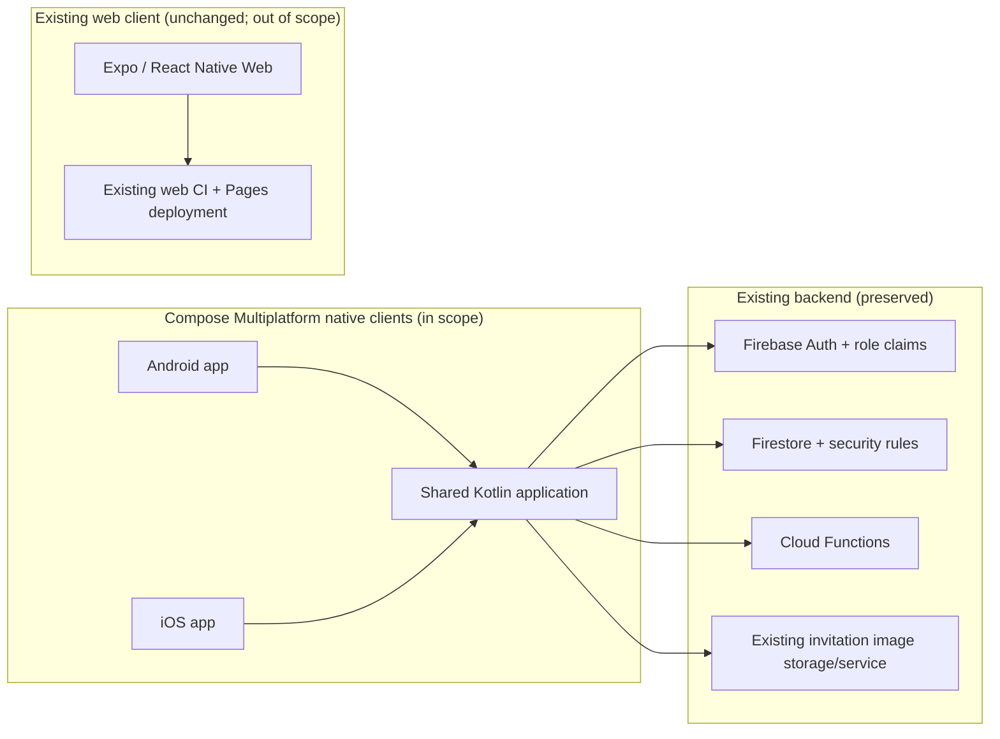
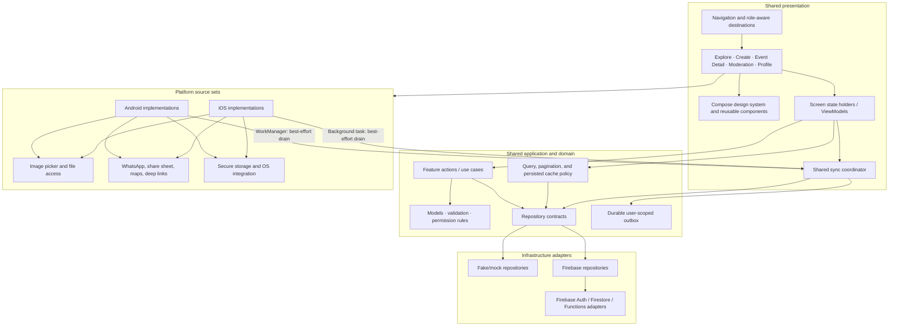
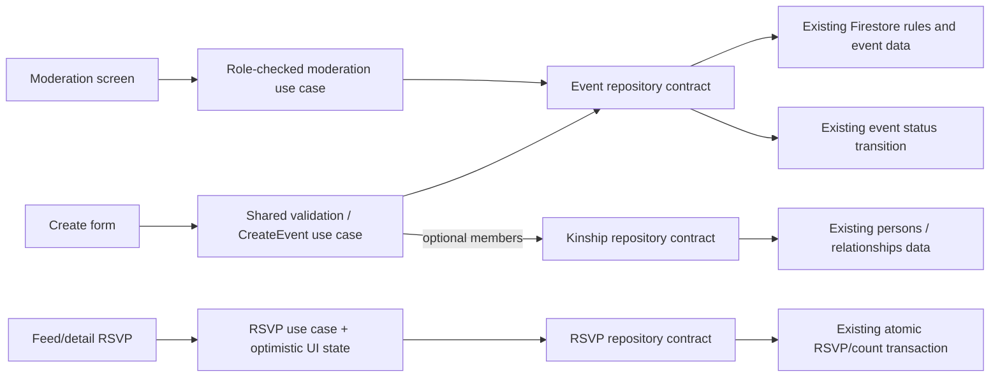
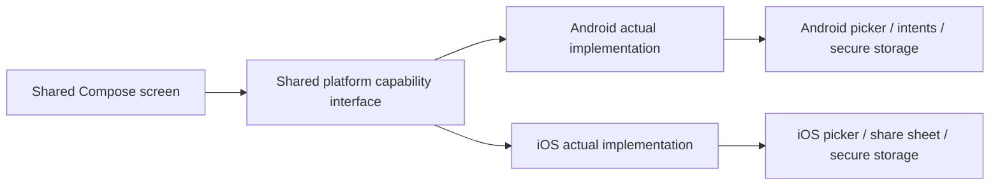
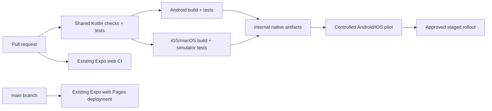

# 07 — Compose Multiplatform Architecture

Proposed target architecture for replacing the native Android and iOS front ends while preserving the existing Firebase backend. This is a migration target, not an implemented architecture; library and SDK choices remain open in the [migration tracker](../COMPOSE_MULTIPLATFORM_MIGRATION.md#decisions-and-open-questions).

## System context



The Compose clients connect to the same Firebase project, collections, roles, and backend behavior as the current app. This migration does not copy data or make the Expo web client a Compose target.

## Shared and platform-specific responsibilities



### Layer boundaries

| Layer | Owns | Must not own |
|-------|------|--------------|
| Shared presentation | Compose screens, navigation, design system, accessible rendering | Firebase calls, authorization decisions, OS APIs directly |
| Shared application/state | Loading/error/content state, filter state, pagination coordination, mutation lifecycle | UI widgets or platform-specific implementations |
| Domain | Typed models, validation, use cases, business permission rules, repository contracts | Compose, Firebase SDK, Android/iOS framework types |
| Infrastructure | Mock and Firebase implementations of repository contracts; mapping and error translation | Screen navigation or rendering |
| Android/iOS source sets | Image/document pickers, share/link intents, secure storage, system UI and lifecycle interop | Duplicated product rules that can be shared |
| Existing web app | Expo web client and its existing release pipeline | Compose migration dependencies |

## Representative data flows

### Browse and filter

```mermaid
sequenceDiagram
  actor User
  participant UI as Compose Explore
  participant State as Shared screen state
  participant Repo as Event repository contract
  participant Firebase as Existing Firestore

  User->>UI: Choose category / enter search
  UI->>State: Update filter state
  State->>State: Debounce search; reset cursor on filter change
  State->>Repo: Request approved page
  Repo->>Firebase: Query approved events with cursor
  Firebase-->>Repo: Page of events
  Repo-->>State: Typed page or explicit error
  State-->>UI: Feed, loading, empty, offline, or error state
```

### Create, moderate, and RSVP



Shared use cases preserve the documented rules: USER-created events remain pending; MOD/ADMIN event creation follows current auto-approval behavior; only MOD+ may moderate; RSVP aggregates remain authoritative in the backend transaction. Navigation visibility is not an authorization boundary.

### External platform actions



Keep message composition, URL validation, and result/error modeling shared where practical. Platform implementations handle OS interaction and return explicit success, cancellation, unavailable, permission-denied, or failure results.

## CI/CD context



The Compose jobs shown are planned; the current repository CI only runs the Expo/web pipeline. See [06 — CI/CD and Test Coverage](06-CI-CD-AND-TEST-COVERAGE.md) for proposed checks and release gates.

## Architecture constraints

- Keep backend schemas and security rules compatible; do not introduce a backend migration as an implicit part of the client port.
- Keep auth role claims and backend permission checks authoritative. The Profile demo role switch must remain confined to mock/emulator or explicitly approved QA builds.
- Use repository contracts between feature logic and Firebase so fake repositories can test shared flows.
- Use the shared sync coordinator and durable outbox for offline RSVP desired state; coalesce to the latest user/event intent and reconcile the result with the server transaction.
- Never queue moderation, role grants, or WhatsApp broadcasts. Keep event creation as a local draft until idempotent create and event/kinship partial-commit recovery are specified.
- For future edits, use server version tokens and surface conflicts; do not silently apply last-write-wins based on device clocks.
- Drain eligible work in foreground and use platform background scheduling only as a best-effort opportunity; never promise execution timing.
- Isolate platform APIs behind small interfaces and implement them separately for Android and iOS.
- Treat image uploads, WhatsApp Cloud broadcast, deep links, cache/offline policy, and auth persistence as explicit integration decisions with tests.
- Preserve Expo web and its CI/Pages deployment until separately changed by an explicit scope decision.
