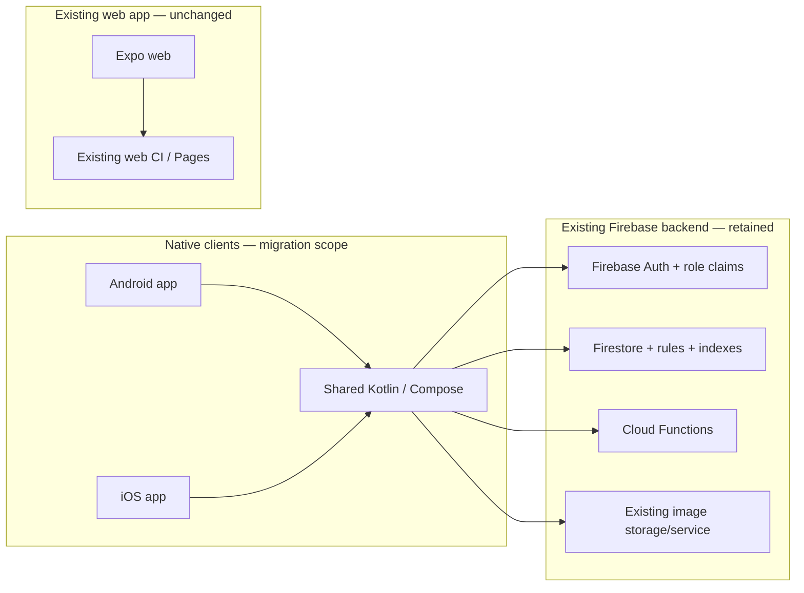
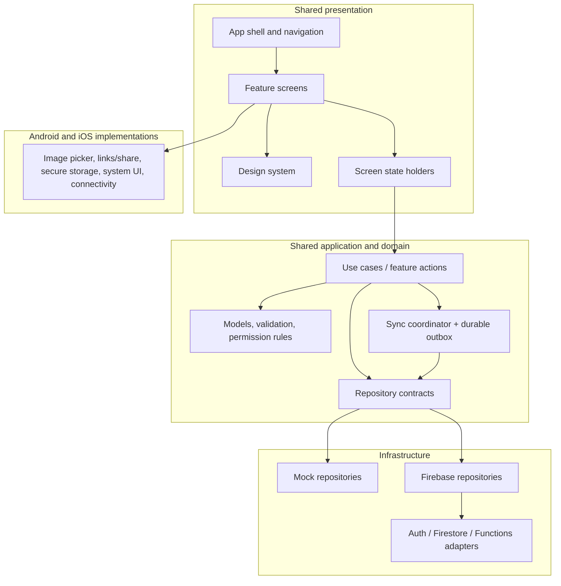
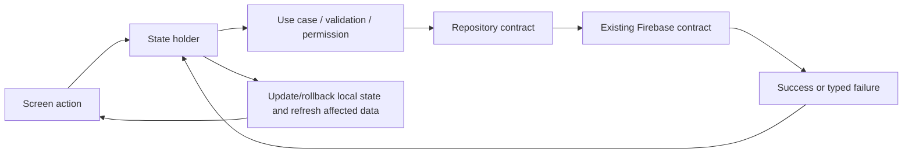

# 08 — Compose Multiplatform High-Level Design (HLD)

## 1. Purpose

Describe the feature-level target design for replacing the current Expo/React Native Android and iOS clients with Compose Multiplatform. This is a proposed design, not a record of implemented Kotlin code.

### Scope

- Android and iOS applications implemented with shared Kotlin/Compose UI and shared product logic where practical.
- Existing Firebase Auth, Firestore, Cloud Functions, security rules, collections, and data remain in place.
- Existing Expo web client and its web CI/Pages deployment remain unchanged and out of scope.

### Design principles

1. Preserve the current product behavior and data contracts before considering feature additions.
2. Keep business rules independent of Compose, Firebase SDK types, and platform APIs.
3. Keep authorization enforced by trusted backend rules/use cases; UI visibility is not security.
4. Share UI and logic by default, isolate platform capabilities behind small interfaces.
5. Model loading, empty, offline, permission, validation, and failure states explicitly.
6. Keep mock/emulator support for deterministic development and tests.

## 2. System context



## 3. Logical architecture



### Layer responsibilities

| Layer | Responsibility | Example |
|-------|----------------|---------|
| Presentation | Render state, collect user actions, navigate | Explore, Create, Detail, Moderation, Profile |
| Application | Coordinate loading, pagination, mutations, cache and session state | Feed state holder, auth bootstrap, RSVP action |
| Domain | Product models, validation, permissions, use cases, repository contracts | CreateEvent, ModerateEvent, RsvpEvent |
| Infrastructure | Implement contracts and translate backend responses/errors | Mock/Firebase event and auth repositories |
| Platform | Invoke OS services and return typed outcomes | Photo picker, WhatsApp/share, maps, secure storage |

## 4. Feature-level high-level design

| Feature | Design responsibility | Main dependencies | Primary outcome |
|---------|-----------------------|------------------|-----------------|
| App shell and navigation | Provide tab destinations, event detail back stack, auth bootstrap, theme and offline surfaces | Auth state, role state, navigation state | Consistent destinations and role-aware visibility |
| Explore and discovery | Search/filter approved events, paginate, show RSVP state | Event repository, current user, RSVP repository/cache | Discoverable approved event feed |
| Event detail | Load event by ID, show event information, offer RSVP/share/maps | Event repository, RSVP, platform link/share adapters | Complete event view and actions |
| Event creation | Validate form, collect category-specific input, preview, optional image/kinship, submit | Create use case, auth, image adapter, kinship contract | Event created with existing status/ownership rules |
| RSVP | Set current user's response, update optimistically, reconcile counts | RSVP use case/repository, transaction-backed backend | Accurate attendee response and counts |
| Moderation | Show pending queue, approve/reject, optional admin broadcast | Role state, event repository/use case, WhatsApp Cloud service | Authorized event status decisions |
| Identity and profile | Bootstrap and display authenticated user, role, RSVP history | Auth/user/RSVP repositories | Restored and visible session/profile state |
| Role management | Preserve admin role-grant rules where UI is in scope | ManageRole use case, grantRole callable | Authorized role changes; UI scope is unresolved |
| Theme | Select Dark/Light/System and persist preference | Theme state, local preference storage | Consistent appearance across destinations |
| Kinship | Capture optional people/relationships and Tamil taxonomy | Kinship domain/repository, create flow | Event-member relationship context |
| Design system and accessibility | Provide tokens, reusable controls, semantics, responsive layout | Design tokens, platform accessibility APIs | Consistent and accessible native UI |
| Native integrations | Provide image, link, share, connectivity, secure storage, system UI | Platform interfaces and Android/iOS implementations | Native capabilities without leaking OS APIs into domain |
| Offline/cache and persistence | Cache reads under explicit freshness/retention rules; persist eligible user operations in an outbox; clear user-scoped state on sign-out/account switch | Persistence adapter, connectivity, repositories, auth lifecycle | Consistent state across navigation/restart without unsafe stale or cross-user data |
| Synchronization and conflict resolution | Drain a durable outbox in foreground and best-effort background; coalesce RSVP intent; reconcile server-version conflicts for edits; exclude privileged/non-idempotent actions unless explicitly made safe | Shared sync coordinator, durable outbox, idempotency/version contracts, platform schedulers | Retryable offline work with server-authoritative outcomes and no duplicate or unauthorized side effects |
| Lifecycle and background execution | Cancel work with its owner, recover in-flight UI state, and schedule only eligible outbox work under OS constraints | Lifecycle-aware state holders, WorkManager adapter on Android, background-task adapter on iOS | Stable behavior through rotation, background/foreground, process death, and OS limits |
| Runtime performance and stability | Control list/image memory, concurrency, duplicate requests, and startup/scroll regressions | Profiling, structured async work, diagnostics | Predictable runtime on representative phones and tablets |
| Observability and release control | Collect privacy-safe crash/error/performance signals; staged cohort rollout and rollback | Monitoring, feature flag/remote config if selected, release pipeline | Detect regressions early and limit rollout impact |

The detailed requirements for each feature are specified in [09 — Low-Level Design](09-LLD.md) and the linked feature guides.

## 5. Main interactions

### Explore read flow

```mermaid
sequenceDiagram
  actor Resident
  participant Screen as Explore
  participant State as Feed state holder
  participant UseCase as Approved-events action
  participant Repo as Event repository
  participant Backend as Firestore
  Resident->>Screen: Change category/search
  Screen->>State: Update filter
  State->>State: Debounce search; reset cursor
  State->>UseCase: Load approved page
  UseCase->>Repo: Query(filter, cursor)
  Repo->>Backend: Approved events query
  Backend-->>Repo: Page
  Repo-->>State: Result
  State-->>Screen: Feed + explicit UI state
```

### Mutation flow



## 6. Cross-cutting requirements

- **Authorization:** USER may create pending events and RSVP; MOD+ moderation and auto-approval follow the current rules; ADMIN-only role grants preserve no-self-demotion. Backend claims/rules remain authoritative.
- **Data compatibility:** keep current event, RSVP, user, person, relationship, village, and template contracts unless separately approved.
- **Errors:** distinguish invalid input, unauthenticated, unauthorized, missing data, offline, backend failure, and platform capability failure.
- **Observability:** record non-sensitive failure and performance signals; do not log personal or kinship content.
- **Lifecycle:** screen-owned async work is cancelled when its owner is no longer active; process restoration restores only deliberately persisted state.
- **Background work:** drain the outbox immediately while foregrounded and request constrained OS-scheduled work for eligible pending operations. Android WorkManager and iOS background-task execution are opportunistic, OS-controlled, and not guaranteed; foreground drain remains the reliability path. Do not add periodic refresh or a foreground service for routine sync.
- **Conflict policy:** the server is authoritative. Coalesce queued RSVP operations for one user/event to the latest desired state; rely on the backend transaction for aggregate counts. For event edits, compare a server version/update token and return a conflict instead of silently overwriting a newer edit. Moderation and WhatsApp broadcasts are never queued.
- **Idempotency:** every queued operation has a stable operation ID, user ID, entity key, type, payload, creation time, attempt metadata, and status. Backend writes retried after an ambiguous timeout must be idempotent or reconciled before retry. Event creation with kinship remains a local draft until event-plus-kinship partial-failure and idempotency contracts are proven.
- **Persistence:** explicitly classify auth secrets, user preference, cache, pending outbox operations, form drafts, and transient UI state. Apply per-class storage, retention, sign-out clearing, and stale-data rules.
- **Runtime:** profile cold start, feed scroll, image memory, and repeated navigation on representative Android phones/tablets; keep platform-specific memory and lifecycle risks visible.
- **Rollout:** release using an agreed cohort strategy; monitor crash-free sessions, startup failures, backend errors, and critical event/RSVP/moderation completion before widening.
- **Quality:** every feature has shared logic tests; platform UI/integration checks cover behavior that depends on Android/iOS APIs.
- **Migration coexistence:** native Compose rollout does not interrupt Expo web or require data migration.

## 7. Key design decisions still open

See the migration tracker for current status. The main implementation choices to resolve are:

- Kotlin Firebase SDK/integration path supported for both target platforms.
- Navigation, state management, serialization, persistence, image, and dependency-injection libraries.
- Parallel app versus staged replacement/cutover strategy.
- Native build/release service, signing model, and simulator/device CI availability.
- Whether a production admin role-management UI is required for parity.
- Exact durable storage technology and schema migration strategy for the outbox.
- Event edit version token/source and backend behavior for version-conflict detection.
- Idempotency/reconciliation support for event creation and multi-write event-plus-kinship submissions before queuing them.
- Retry limits, backoff values, conflict UI, and maximum outbox retention.
- Whether push notifications are required; background task scheduling does not imply notifications.
- Acceptable visual differences from Expo.
- Durable local database necessity and data-retention/security rules.
- Whether background work/notification support is a product requirement; if so, task ownership, scheduler, backoff, constraints, idempotency, and user-visible status.
- Tablet layout targets, supported Android API/device matrix, and runtime performance budgets.
- Crash/performance observability provider, privacy filters, rollout cohorts/flags, and rollback thresholds.
