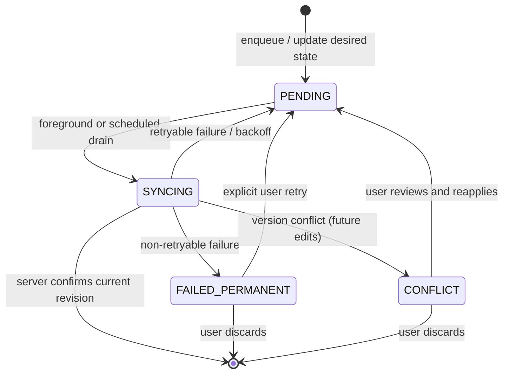

# 09 — Compose Multiplatform Low-Level Design (LLD)

## 1. Purpose and implementation status

Translate the feature requirements into screen contracts, state, actions, data boundaries, platform interfaces, and verification. Most sections remain proposed implementation specifications. The initial RSVP outbox slice is implemented in `composeApp/shared`: `RsvpOutboxSyncCoordinator`, `RoomRsvpOutboxStore`, and the Room DAO/entity define durable coalescing, revision-safe acknowledgement, leases, retry classification, and user-scoped pending-operation observation. Android scheduling is represented by a WorkManager adapter. These pieces are not yet wired to the Compose app or Firebase, and iOS background scheduling remains unimplemented.

Feature-specific behavior is also documented in:

- [Explore and navigation](01-EXPLORE-AND-NAVIGATION.md)
- [Event lifecycle](02-EVENT-LIFECYCLE.md)
- [Identity and kinship](03-IDENTITY-AND-KINSHIP.md)
- [UI and platform integrations](04-UI-AND-PLATFORM-INTEGRATIONS.md)
- [Verification and rollout](05-VERIFICATION-AND-ROLLOUT.md)
- [CI/CD and test coverage](06-CI-CD-AND-TEST-COVERAGE.md)

## 2. Shared conventions

### UI state and actions

Each screen state holder exposes immutable render state and accepts explicit actions. Keep asynchronous work out of composables and convert repository/domain results into UI states at the application boundary.

Conceptual result shape:

```text
LoadState<T> =
  Loading
  Content(value: T, refreshing: Boolean)
  Empty
  Failure(error: UserVisibleError, retryable: Boolean)
```

Mutation state should be tracked per relevant entity/action so one in-flight RSVP or moderation action does not disable unrelated controls.

### Domain and repository boundaries

Use typed models/enums rather than UI strings for categories, roles, event status, RSVP status, and theme mode. Repository contracts return domain values or explicit failures and do not expose Firebase SDK objects.

Conceptual contracts to implement:

```text
EventRepository
  getApprovedEvents(category?, query?, cursor?): Page<CommunityEvent>
  getPendingEvents(): List<CommunityEvent>
  getEventById(id): CommunityEvent?
  createEvent(input): CommunityEvent
  updateEventStatus(id, status, moderatorId)
  rsvpToEvent(eventId, userId, status): RSVP
  getUserRsvps(userId): Map<EventId, RSVPStatus>

AuthRepository
  currentUser(): User?
  observeAuthState(listener): Subscription
  signOut()

UserRepository
  getUserById(uid): User?
  updateUserRole(uid, role)

KinshipRepository
  saveEventKinship(organizerId, members, relationships)
```

These signatures express existing contracts and expected Kotlin equivalents; they are not a commitment to specific suspend/Flow/library syntax.

### Error mapping

Map transport/platform exceptions to stable categories at adapter boundaries: `Unauthenticated`, `Unauthorized`, `NotFound`, `Validation`, `Offline`, `Conflict`, `Unavailable`, and `Unknown`. Preserve diagnostic causes for safe logs, but show concise, actionable text to users. Never map failure to empty success.

## 3. Feature-by-feature low-level design

### 3.1 App shell, auth bootstrap, and navigation

**Destinations:** Explore, Create, Moderation, Profile tabs; Event Detail stack destination with required event ID.

**State:** auth initialization (`Initializing`, `SignedIn(user)`, `SignedOut`), selected destination, system back stack, theme mode, connectivity banner state.

**Actions:** `AuthStateChanged`, `SelectTab`, `OpenEvent(id)`, `Back`, `DeepLinkReceived(uri)`, `RetryAuth`.

**Rules:**

- Do not render an assumed ADMIN while auth is unresolved.
- Hide Moderation from USER navigation; still invoke role-checked use cases/backend rules if route/action is reached.
- Restore event detail only with a valid ID; show not-found for absent/deleted events.
- Deep links are parsed and validated before navigation.

**Tests:** auth observer updates, role-based tab visibility, back stack, invalid/missing event link, and app relaunch/session restoration.

### 3.2 Explore and discovery

**State:** selected category (`ALL` default), raw search, debounced search (300 ms), loaded pages, next cursor, loading-next-page flag, refresh state, feed failure, per-event RSVP state.

**Actions:** `SelectCategory`, `EditSearch`, `Refresh`, `LoadNextPage`, `Retry`, `SelectRsvp(eventId, status)`, `OpenEvent(id)`.

**Rules:**

- Convert `ALL` to no category filter. Only approved events belong in this feed.
- Debounce search by 300 ms. Category or debounced-search changes clear pages and reset cursor.
- Prevent concurrent next-page calls; stop when the repository returns no next cursor.
- Key cached feed state by category + debounced search. Keep existing approved-feed freshness intent (5 minutes) unless measured behavior requires a decision.
- Render loading, populated, empty, offline-with-cache, and recoverable failure states distinctly.

**Tests:** filter/search key separation, debounce, pagination without duplicate requests, end-of-list behavior, approved-only results, retry, RSVP state display, lifecycle cancellation, stale-cache behavior, and large-list scroll performance.

### 3.3 Event creation

**Form state:** category; core fields (title, date, time, venue, maps URL, details); category-specific fields; optional invitation image; optional event members/relationships; field errors; submitting/success/failure state.

**Actions:** `SelectCategory`, `UpdateField`, `PickImage`, `AddMember`, `RemoveMember`, `UpdateRelationship`, `Submit`, `DismissResult`.

**Submit sequence:**

1. Build a typed `CreateEventInput` using current authenticated organizer ID.
2. Validate required fields, date/time and URL formats, category-specific constraints, and schema rules.
3. Resolve selected image through the platform picker/upload boundary if the existing contract requires upload before event create.
4. Call `CreateEvent` use case. Do not let UI set a trusted moderator ID or bypass status logic.
5. Repository creates PENDING; existing use-case role rule auto-approves MOD/ADMIN submissions.
6. Persist kinship payload only when supplied and feature is enabled.
7. On success, invalidate/refresh approved and pending data, show confirmation, and navigate to agreed destination.
8. On failure, preserve entered form state and show recoverable feedback.

**Recovery:** define whether partially completed image upload can be safely retried or orphaned; avoid creating duplicate events after an ambiguous network timeout. If backend idempotency is unavailable, expose an explicit uncertain result and reconcile by organizer/event data before retrying.

**Tests:** schema parity, category-specific validation, organizer identity, USER pending, MOD/ADMIN auto-approval, duplicate submit prevention, upload failure, optional kinship and retry behavior, process recreation during draft editing, and partial/ambiguous completion.

### 3.4 Event detail

**Input:** event ID from navigation/deep link.

**State:** event load state, current user's RSVP, mutation status, share status, map action status.

**Actions:** `Load(id)`, `Retry`, `SelectRsvp(status)`, `Share`, `OpenMap`, `Back`.

**Rendering:** invitation image or fallback; category/status; title; date/time; venue; marriage/meeting extras; details; attending/declined counts; RSVP chips; optional WhatsApp/share and maps actions.

**Rules:** do not show invented/placeholder data on load errors; distinguish not-found from failure. Only offer maps when a valid maps URL exists. Open Graph HTML generation remains on the existing web/backend path.

**Tests:** success/loading/not-found/error; category-specific details; valid/missing maps URL; share handler success/unavailable; RSVP integration.

### 3.5 RSVP

**Input:** authenticated user ID, event ID, target status `ATTENDING` or `DECLINED`.

**State:** confirmed RSVP, optimistic target RSVP, in-flight state, last confirmed counts, mutation error.

**Sequence:** snapshot current RSVP/count state → apply optimistic user RSVP presentation → invoke use case/repository transaction → on success reconcile with returned server values and refresh event/feed/user RSVP → on failure restore snapshot and present retry.

**Rules:** backend transaction is authoritative for count changes. Switching ATTENDING↔DECLINED changes counts atomically; never increment shared count only from local UI. Follow current app semantics for selecting an already-selected value. Per the agreed hybrid outbox strategy, an offline RSVP can be queued durably as the latest desired state for that user/event; it must show a pending/syncing state and reconcile with the server.

**Conflict resolution:** key pending RSVP intent by `(userId, eventId)` and replace/coalesce the queued target status when the user changes their choice before sync. Do not enqueue each intermediate tap. On sync, submit the final desired status to the existing atomic RSVP transaction. The transaction compares the server's prior RSVP with the desired state and applies count deltas once. On success, discard the outbox entry and refresh server counts. On auth expiry, require re-authentication and retain the operation only under the same user identity. On permanent rejection, mark failed and offer an explicit retry/cancel action; never show the optimistic count as confirmed.

If the desired RSVP changes while a request is already in flight, increment the outbox revision and retain the newer desired state. When the in-flight response returns, remove the row only if its revision still matches the submitted revision; otherwise retain and schedule another drain for the newer intent. The Android `FirebaseRsvpSyncGateway` writes the same `events` and `rsvps` documents as the Expo client and applies the existing count-transition rules in a Firestore transaction. It checks that the active Firebase UID matches the outbox owner before writing, treats invalid prior RSVP state as permanent failure, and classifies authentication, permission, and transient Firestore errors. The Android runtime factory composes this gateway with Room and WorkManager; the Android app must install it at startup and invoke foreground drains when appropriate. The existing Firestore transaction is idempotent for repeated desired statuses because count deltas are applied only for first RSVP or a status transition. The iOS gateway remains for the follow-on phase.

**Tests:** new RSVP, state switch in both directions, rapid duplicate tap, transaction failure rollback, stale count reconciliation, unauthenticated action, offline coalescing, duplicate delivery, auth change, permanent rejection, app background/foreground during mutation, and process restart without false success.

### 3.6 Moderation and WhatsApp Cloud broadcast

**Queue state:** pending items, queue load state, per-event status mutation, per-event broadcast mutation.

**Moderation actions:** `LoadQueue`, `Retry`, `Approve(eventId)`, `Reject(eventId)`.

**Moderation rules:** only MOD/ADMIN; use case and backend enforce authorization. On successful status change, refresh pending and approved feed. Do not remove a card optimistically unless rollback/error handling is implemented. Status changes must not be queued for silent background retry; reconcile ambiguous timeout responses before offering a repeat action.

**Broadcast action:** `Broadcast(eventId)` calls the existing configured WhatsApp Cloud service, independent of approve/reject. Show per-event sending state; prevent duplicate send for that event. Report recipient count on success and configuration/provider failures explicitly. Broadcast failure must not reverse event moderation status.

**Tests:** USER denied at use-case/backend boundary, MOD/ADMIN allowed, approve/reject status transitions, queue refresh, duplicate moderation tap, broadcast success/failure/config missing, no coupling of broadcast and approval, lifecycle interruption, and ambiguous-result recovery.

**Outbox exclusion:** approval, rejection, role grants, and WhatsApp Cloud broadcasts are never stored as background operations. Require a live authenticated request and server authorization. If a request times out ambiguously, reload authoritative state before offering a retry; a broadcast must not be automatically repeated without provider idempotency.

### 3.7 Identity, profile, and role management

**Auth bootstrap:** subscribe once per app lifecycle owner, expose initialization state, map auth identity/claims into `User`, unsubscribe on disposal.

**Profile state:** user display fields, role, RSVP history loading/content/empty/error, theme selection.

**Demo role switch:** available only in mock/emulator or explicit QA build. It signs into demo identities; it must never mutate production claims or act as role-grant UI.

**Role management:** preserve existing `ManageRoleUseCase` and `grantRole` contract. Only ADMIN may grant; ADMIN cannot demote self. The current documented screens do not establish a production user-management screen; confirm UI scope before building one.

**Tests:** auth observer bootstrap, signed-out/expired states, session restoration, demo-only guard, role claim mapping, ADMIN role-grant permission, self-demotion rejection.

### 3.8 Theme and preferences

**State:** selected mode `SYSTEM`, `LIGHT`, or `DARK`; effective mode resolved from device when SYSTEM.

**Actions:** `SelectTheme(mode)`, `SystemAppearanceChanged(mode)`.

**Rules:** persist selected mode with a local preferences abstraction. Apply consistently to tabs, dialogs, status/system bars, text, controls, imagery surfaces. Avoid storing secrets in theme preferences.

**Tests:** persistence across process restart, SYSTEM follows OS change, all theme-dependent component states remain legible.

### 3.9 Kinship and event member attachment

**Models:** Person, Relationship, lineage category, context tag, event member, organizer-relative relationship.

**UI state/actions:** selected members, editable display name/role, relationship choice, context tag, validation/removal.

**Rules:** taxonomy labels and inverse mapping remain data-driven and preserve current Tamil relationship terms. Kinship remains optional. Persist through the existing persons/relationships contract only as part of the supported event flow.

**Tests:** taxonomy/inverse pairs, lineage/context mapping, member add/remove, relationship validation, no-kinship create path, emulator persistence/readback.

### 3.10 Design system and accessibility

**Token mapping:** translate `design-tokens.json` into typed Compose theme structures for dark/light colors, typography, spacing, radius, segment/input/chip/glow token families, and kinship tokens.

**Components:** ThemedText, SegmentPill, ActionChip, SelectableCard, SearchField, LiquidGlassCard equivalent, RoleBadge, EventListItem, OfflineBanner, form field/error.

**Rules:** keep selected/disabled/focus/error states semantic and accessible; do not rely on color alone. Add labels, state descriptions, scalable text, keyboard/focus behavior and adequate touch targets. Blur/aurora are optional effects; document intentional visual differences and profile list rendering.

**Tests:** token contract, component semantics, light/dark snapshots on both platforms, TalkBack/VoiceOver smoke, dynamic text and contrast review, long-list performance.

### 3.11 Native platform capability interfaces

Define shared interfaces with typed outcomes; implementation syntax is library-dependent:

```text
ImagePicker.pickImage(): Cancelled | Selected(asset) | PermissionDenied | Failure
ImageUploader.upload(asset): Uploaded(url) | Failure
ExternalActions.share(message, url): Completed | Unavailable | Cancelled | Failure
ExternalActions.openUrl(url): Opened | InvalidUrl | Unavailable | Failure
SecurePreferences.read(key) / write(key, value) / delete(key)
Connectivity.observe(): Flow<Online | Offline | Unknown>
```

Android and iOS implementations own OS permissions, URI/file handling, intent/share sheet, URL opening, secure storage, connectivity observation, safe areas and system bars. Shared code owns validation, message composition, domain decisions, and rendering of results.

**Tests:** shared fake capability tests; platform tests for selection/cancellation/denial, upload failure, WhatsApp unavailable/fallback, maps handler unavailable, secure-store behavior, connectivity transitions, lifecycle disposal.

### 3.12 Persistence, offline, synchronization, and recovery

- First classify state before selecting a database: credentials/tokens, user preferences, approved feed/detail cache, RSVP cache/outbox, unsent event drafts, and transient screen state have different security and recovery requirements.
- Keep secrets in platform-protected storage. Keep theme preference in ordinary preferences. Persist event/RSVP cache or drafts only after retention, encryption/access, invalidation, and sign-out clearing rules are agreed.
- A durable local store is required for the selected outbox so queued work survives process death. Choose a multiplatform database/storage layer during foundation work and define schema versioning/migrations before production data is persisted.
- Prefer the existing backend as source of truth. Cache approved feed/detail under a bounded freshness policy; user-specific cache/outbox rows must be partitioned by authenticated UID and cleared or quarantined on sign-out/account switch.
- Show stale/cached data as such when offline. Do not present stale authorization-sensitive queue data as current or allow moderation from stale cache without server confirmation.
- Preserve form drafts on recoverable app recreation only if product/privacy policy allows; do not persist image bytes or sensitive kinship information by default.
- **Eligible queued operation (initial scope):** RSVP desired state only; coalesce per `(uid,eventId)` to the latest status and preserve one operation identity while updating the desired state/revision.
- **Not queued initially:** moderation, role changes, and WhatsApp broadcasts. Event creation may be saved as an unsent local draft, but is not submitted in the background until backend idempotency and event-plus-kinship partial-commit/reconciliation behavior are specified and tested.
- **Event edits (future, if supported):** include the server-observed entity version/update token in the command. Server accepts only if the version still matches; otherwise return `Conflict(latestServerEntity)`. Do not use device timestamps or last-write-wins to overwrite another user's edit silently.
- Outbox entries contain a stable `operationId`, `uid`, operation type, entity key, desired-state payload, enqueue/update timestamps, attempt count, next eligible attempt, and status (`PENDING`, `SYNCING`, `FAILED_RETRYABLE`, `CONFLICT`, `FAILED_PERMANENT`). Store only the minimum data needed; do not store auth tokens or image bytes in the operation payload.
- Require stable idempotency for retryable server commands. For RSVP, the existing per-user/event RSVP document and transaction should make applying the same desired status idempotent; verify this in adapter/emulator tests. If a response is ambiguous, read authoritative RSVP/event state before retrying.
- Drain in foreground on app start, connectivity restoration, and user action; schedule unique constrained background work for Android/iOS as a best-effort opportunity. Use network-connected constraints, bounded exponential backoff with jitter, cancellation, and per-user isolation. Do not promise a sync deadline.
- Use structured concurrency: cancel requests when owners are disposed, avoid unbounded parallel writes, serialize conflicting operations for an entity, and prevent results from an old user/session applying after sign-out or account switch.
- On process restart, rebuild transient state from backend/cache according to policy; never restore an optimistic mutation as confirmed success without server acknowledgement.

**Tests:** offline initial launch, stale cached feed, reconnect drain, RSVP coalescing, duplicate delivery/idempotency, retry/backoff and permanent failure, auth expiry during retry, sign-out/user switch isolation, interrupted writes, server conflict for versioned edits, and process-death recovery.

#### Outbox operation state



Use bounded retry with exponential backoff and jitter for retryable failures. Exact maximum attempts and retention are release-policy decisions; exhausted operations become visibly failed rather than retrying forever.

#### Outbox conflict policy

| Operation / condition | Resolution |
|-----------------------|------------|
| Same user changes RSVP for same event multiple times while offline | Coalesce to the latest desired status; do not send intermediate states. |
| RSVP arrives while an earlier revision is in flight | Keep the newer revision. Apply the response only to the submitted revision; then drain the newer desired state. |
| Duplicate delivery or timeout after RSVP commit | Reconcile the user's RSVP from the server transaction/document; repeat the same desired-state command only if needed. Counts are derived atomically by the backend. |
| Another device changes that same user's RSVP | This device's most recent explicit queued intent wins when it next reaches the server; show syncing/pending until server confirmation and then display authoritative state. |
| Future event edit races with another editor | Reject stale `baseVersion` with a conflict and latest server entity; user reviews/reapplies. Never silently overwrite via device-clock last-write-wins. |
| Moderation, role grant, or WhatsApp broadcast is offline/ambiguous | Do not queue or auto-replay. Re-read authoritative state; require a fresh user action when safe. Never automatically repeat a broadcast without provider idempotency. |
| Event creation or event-plus-kinship write has partial/ambiguous outcome | Retain as local draft. Do not background-submit until server idempotency and partial-commit reconciliation are implemented and tested. |
| Auth expires or account changes while operation is pending | Pause drain. Keep operation bound to original UID; never submit as another user. Re-auth as same UID to resume, otherwise require explicit discard/account resolution. |

Initial RSVP policy is intentionally latest-intent-wins for a single user's response to one event; it does not merge aggregate counts locally. Server rules and transactions remain authoritative.

### 3.13 Lifecycle, background execution, and restart behavior

- Bind screen requests and observers to lifecycle-aware owners; cancel obsolete searches and pagination requests.
- Re-collect state safely after configuration changes and foreground return without duplicate subscriptions or duplicate mutations.
- Start a sync drain while foregrounded when the authenticated user is ready; trigger another drain on connectivity restoration and app resume.
- Android: use unique WorkManager work for eligible outbox entries with network constraints, bounded backoff, and a UID/session guard; cancel or stop stale work on sign-out. Do not use a foreground service for routine event/RSVP sync.
- iOS: use the supported background task mechanism as a best-effort drain opportunity; retain foreground drain as the reliability path and do not promise Android-equivalent execution timing.
- Test process death during event form editing, image upload, RSVP, and moderation. Restore only state explicitly covered by persistence policy; reconcile backend-owned actions. A pending RSVP survives restart; an unacknowledged moderation/broadcast does not auto-replay.

**Tests:** rotate/recreate, background/foreground, connectivity restoration, navigate away during request, sign out during request, force-stop/relaunch at each sync phase, unique-work deduplication, scheduler retry/cancel, and iOS best-effort resumption.

### 3.14 Android tablet and responsive layouts

- Support window resizing, landscape, and larger widths without stretching phone layouts edge-to-edge.
- Use adaptive content widths and consider list/detail or navigation-rail layouts only where they improve existing workflows; do not change product navigation semantics.
- Preserve role gates, keyboard/form behavior, event information hierarchy, and touch targets at tablet sizes.
- Test compact, medium, and expanded widths, split-screen/window resizing, large font, and external keyboard/focus where supported.

**Tests:** Compose UI tests across representative width classes plus manual Android tablet review; verify no clipping, unreachable controls, or changed authorization behavior.

### 3.15 Diagnostics, performance, and rollout controls

- Add a narrow diagnostics boundary for non-sensitive errors, crashes, startup failures, request latency, and critical flow outcomes.
- Remove/redact event titles, phone numbers, user IDs where unnecessary, auth tokens, invitation URLs, and kinship payloads from logs and breadcrumbs.
- Establish measurable budgets from baseline profiling for cold start, feed scroll/frame stability, image memory, and request concurrency before setting blocking thresholds.
- Use staged rollout cohorts or remote config only if an available release mechanism supports them; keep server-side authorization independent of feature flags.
- Define stop/rollback thresholds for crashes, startup failures, auth/backend error spikes, and create/RSVP/moderation completion regressions. Assign an owner to evaluate signals and pause rollout.

**Tests/release checks:** verify redaction, diagnostics delivery in non-production test environments, performance baselines on low/mid-range Android phone/tablet, flag-off/rollback behavior if flags are used, and a documented manual rollback when native distribution cannot instantly revert.

## 4. Cross-feature test matrix

| Feature | Shared unit/state tests | Backend/emulator tests | Android/iOS UI or platform tests |
|---------|--------------------------|------------------------|----------------------------------|
| App shell/auth/navigation | Auth state, role route policy, deep-link parser | Auth claims/session where available | Tabs, back, deep link, auth restore |
| Explore | Filters, debounce, cursor, error state, cancellation | Approved query/permissions | Feed filter/search/scroll, tablet/resized layout |
| Create | Schema, role behavior, optional kinship, duplicate/recovery | Create/status/kinship writes | Validation, image pick, submit, restart recovery |
| Detail/RSVP | Detail state, optimistic update/rollback, interruption | Atomic RSVP count transaction | Detail, RSVP, map/share, background/restart |
| Moderation | Permission/status transitions, ambiguous result | Rules and status updates | Queue, role gate, approve/reject, lifecycle interruption |
| WhatsApp Cloud broadcast | Result mapping/duplicate guard | Controlled callable/provider contract if applicable | Admin action and failure state |
| Profile/role management | Claim mapping, grant rules | `grantRole` contract | Profile and confirmed role UI scope |
| Theme/design/accessibility | Token and preference tests | N/A | Light/dark/system, TalkBack/VoiceOver |
| Kinship | Taxonomy, inverse mapping, validation | Collection read/write | Picker and relationship selection |
| Persistence/sync/recovery | Cache policy, outbox coalescing, retries, idempotency, session isolation | Server reconciliation and transactions | Airplane mode, process death, restart, sign-out |
| Platform integrations | Fake adapter and error-result tests | Existing adapter contract | OS capability, tablet/window resize, airplane mode |
| Diagnostics/performance | Redaction and metrics mapping tests | Non-production telemetry integration if selected | Startup, memory, scroll and pilot health |

## 5. Non-functional requirements

- Paginated lists do not issue duplicate page requests and remain responsive with large fixtures.
- Backend counts and permissions remain authoritative.
- Sensitive auth/session data uses platform-protected storage selected by architecture decision.
- Every persisted data class has an owner, retention/invalidation rule, and sign-out/user-switch policy.
- Lifecycle-owned work is cancellable; results from obsolete requests or prior auth sessions cannot overwrite current UI state.
- Eligible RSVP work is drained in foreground and scheduled best-effort in the background with bounded retries, idempotency, constraints, and restart tests.
- Critical flows recover from process death without treating unacknowledged writes as successful.
- Android phone/tablet layouts and representative low/mid-range runtime performance are reviewed against explicit release criteria.
- User-visible errors are actionable; diagnostics avoid personal/kinship payloads.
- Rollouts have observable health signals, named decision owner, staged expansion, and executable rollback.
- Shared Kotlin changes are compiled and tested for both Android and iOS targets.
- Native CI and release gates follow [06 — CI/CD and Test Coverage](06-CI-CD-AND-TEST-COVERAGE.md).

## 6. Decisions required before implementation

Do not infer the following from this LLD; record decisions in the migration tracker:

- Firebase SDK approach and feature support on both Android and iOS.
- Compose navigation/state/cache/persistence/image libraries and exact source-set/module layout.
- Whether role-management UI is in scope.
- Durable outbox store/serializer and schema migration mechanism.
- Exact retry ceilings/backoff, outbox retention, failed-item UX, and user-visible pending indicators.
- Server version token and conflict presentation for event edits if/when event editing is added.
- Backend idempotency/reconciliation contract for event creation plus kinship writes before enabling queued submission.
- Whether notifications are required; they are not included by selecting background sync.
- Process restoration requirements for forms, uploads, RSVP, and moderation.
- Android supported API/device matrix, tablet breakpoints, and startup/list/image performance thresholds.
- Crash/performance telemetry provider, data redaction policy, rollout controls, and rollback ownership.
- Image upload source and storage adapter (the current blueprint does not specify all upload details).
- Whether a system share fallback is acceptable when WhatsApp is unavailable.
- Native screenshot, UI test, CI runner, signing, and internal distribution strategy.
